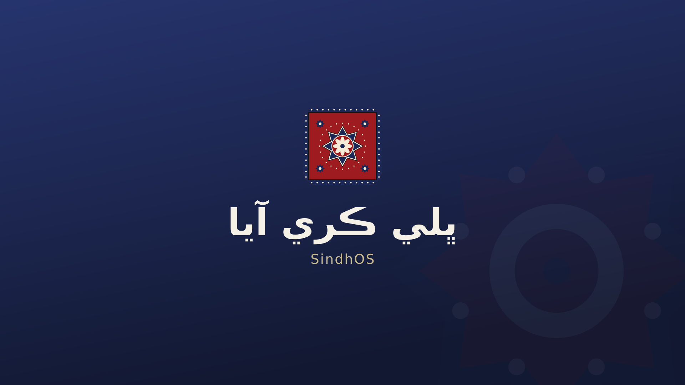

# SindhOS · سنڌ او ايس

A light Linux for everyday laptops, with Sindhi built in from the first boot.
Runs on everyday PCs: 2 GB RAM minimum, 4 GB recommended.



## What it is

- **Sindhi first:** Sindhi fonts (SIL Lateef, made for Sindhi), Sindhi and Urdu locales
- **Roman Sindhi typing, Gboard-style:** type `sindhi boli` in English letters and get **سنڌي ٻولي**, with numbered suggestions when a spelling fits more than one word; your choices are remembered. Works offline from a 62,000-word Sindhi list
- **Sindhi keyboard (key by key):** the second Sindhi keyboard, called just **Sindhi**: each key types one letter (`B U t Y` gives **سنڌي**). **Ctrl+Space** goes English → Roman Sindhi → Sindhi; **Alt+Shift** back to the last one; or use the taskbar button
- **Keyboard guide app:** *Sindhi Keyboard Guide* shows every key, the marks and punctuation, in Sindhi and English
- **Its own look:** one indigo taskbar with the Sindhi **topi** as the menu button and logo, clean light windows with **– □ ×** at the top right, ajrak red as the accent colour (SindhOS theme on adw-gtk3, Papirus icons, Inter font)
- **Welcomes you in Sindhi:** the boot screen says **ڀلي ڪري آيا**
- **Runs on low-end machines:** XFCE desktop and a small set of apps, idle desktop under 600 MB; tested in QEMU with 2 GB and 4 GB RAM
- **A normal Linux underneath:** login with your username and password, `sudo`, `su`, terminal, Firefox, **Super+Space** to search apps
- **`sindh` = `sudo`:** type `sindh apt update` or `sudo apt update`, both work the same, no warnings
- **Built on Debian 13:** security updates come straight from Debian, so the system stays safe for years

## Try it

1. Open the **Actions** tab, then the latest green **Build ISO** run, and download `sindhos-iso`
2. Unzip it to get `sindhos-amd64.hybrid.iso`
3. Test it in **VirtualBox** first (2 GB RAM, boot from the ISO)
4. Write it to a USB stick with **balenaEtcher** or **Ventoy** to boot a real laptop

On the live system the user is `sindhi` with password `live`. Click **Install** on the desktop to install it. The installer asks for your own username and password.

## Build it yourself

On Debian 13:

```sh
sudo apt install live-build librsvg2-bin fonts-sil-lateef fonts-dejavu-core
sudo ./build.sh
```

On any other Linux (e.g. Ubuntu), use a Debian build chroot. Set it up once:

```sh
sudo tools/setup-build-host.sh                 # asks for your password on every build
sudo tools/setup-build-host.sh --passwordless  # or: builds run without a password
```

Then build and test:

```sh
tools/build.sh                     # test build (fast zstd), ISO and log in out/
tools/build.sh --release           # release build (xz, smaller ISO)
tools/build.sh --clean             # remove old build leftovers, keep downloads
tools/boot-test.py                 # boots it in QEMU, screenshots in shots/
tools/boot-test.py --mem 4096      # recommended-size check
tools/boot-test.py --uefi          # UEFI boot
tools/boot-test.py --gui           # try it yourself in a window
tools/ram-check.py                 # memory use as text at 2 GB (serial console)
```

Files in `cache/` (not in git) are used instead of downloads during the build:
`broadcom-wl-6.30.163.46.tar.bz2` and `wl_apsta-3.130.20.0.o` (Broadcom wifi
firmware). Without them the firmware installers download them while building.

## Project layout

| Path | What it does |
|---|---|
| `build.sh` | Configures and runs Debian live-build |
| `config/package-lists/` | Which apps go into the system |
| `config/hooks/normal/` | Setup that runs while the image is built (languages, splash, wallpaper) |
| `config/includes.chroot/` | Files copied into the system (boot splash, login screen, keyboard) |
| `keyboard/roman/` | The SindhOS IBus engine: "Roman Sindhi" (Gboard-style, spelling rules in `rules.py`, Sindhi word list) and "Sindhi" (key by key) |
| `keyboard/layout.py` | The "Sindhi" key-by-key layout. Edit it, then run `python3 keyboard/gen.py` to update the keyboard guide |
| `tools/` | Local build (Debian chroot), QEMU boot test and RAM check |
| `branding/` | Logo, topi, palette, theme (`branding/theme`) and artwork sources (`gen_artwork.py`) |
| `.github/workflows/` | Builds the ISO automatically on every push |

## Roadmap

See [ROADMAP.md](ROADMAP.md): branding and the Gboard-style keyboard, a
Sindhi-poetry lock screen, wallpapers, spell checking, an offline Sindhi
dictionary and Sindhi-friendly apps.
