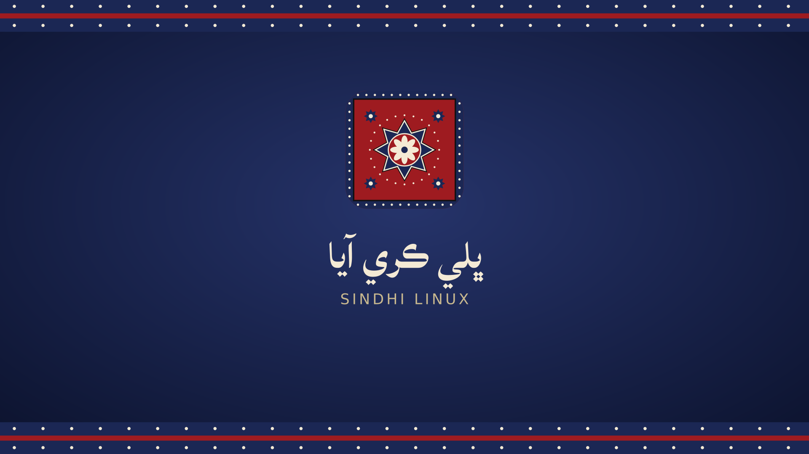

# Sindhi Linux · سنڌي لينڪس

A light Linux for everyday laptops, with Sindhi built in from the first boot.



## What it is

- **Sindhi first:** Sindhi fonts (SIL Lateef, made for Sindhi), Sindhi and Urdu locales
- **Roman Sindhi keyboard:** type Sindhi on a normal English keyboard by sound, `B U t Y` gives **سنڌي**. Switch with **Ctrl+Space** (like macOS), **Alt+Shift** or the top-bar button. Types real Unicode Sindhi, right-to-left, with joined letters
- **Keyboard guide app:** *Sindhi Keyboard Guide* in the Applications menu shows every key, the marks and punctuation, in Sindhi and English
- **Ajrak look:** the logo, boot screen, login screen and wallpaper use an ajrak-style pattern
- **Welcomes you in Sindhi:** the boot and login screens say **ڀلي ڪري آيا**
- **Runs on low-end machines:** XFCE desktop, a small set of apps, aimed at 2–4 GB RAM laptops
- **Mac-style desktop:** top bar, dock with magnifying icons, rounded windows with close/minimize/maximize on the left, **Super+Space** search like Spotlight (WhiteSur theme, Papirus icons, Inter font)
- **A normal Linux underneath:** login with your username and password, `sudo`, `su`, terminal, Firefox
- **`sindh` = `sudo`:** type `sindh apt update` or `sudo apt update`, both work the same, no warnings
- **Built on Debian 13:** security updates come straight from Debian, so the system stays safe for years

## Try it

1. Open the **Actions** tab, then the latest green **Build ISO** run, and download `sindhi-linux-iso`
2. Unzip it to get `sindhi-linux-amd64.hybrid.iso`
3. Test it in **VirtualBox** first (2 GB RAM, boot from the ISO)
4. Write it to a USB stick with **balenaEtcher** or **Ventoy** to boot a real laptop

On the live system the user is `sindhi` with password `live`. Click **Install** on the desktop to install it. The installer asks for your own username and password.

## Build it yourself

On Debian 13:

```sh
sudo apt install live-build
sudo ./build.sh
```

## Project layout

| Path | What it does |
|---|---|
| `build.sh` | Configures and runs Debian live-build |
| `config/package-lists/` | Which apps go into the system |
| `config/hooks/normal/` | Setup that runs while the image is built (languages, splash, wallpaper) |
| `config/includes.chroot/` | Files copied into the system (boot splash, login screen, keyboard) |
| `keyboard/layout.py` | The Roman Sindhi layout. Edit this, then run `python3 keyboard/gen.py` |
| `branding/` | Logo and artwork sources |
| `.github/workflows/` | Builds the ISO automatically on every push |

## Roadmap

- Sindhi (Pakistan) `sd_PK` locale, so dates, numbers and the interface follow Pakistani Sindhi
- Sindhi translation of the desktop menus
- Installer slideshow in Sindhi
- An extra-light edition for 2 GB machines
